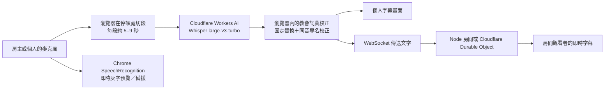

# 語音、字幕與教會詞彙

## 目前實作



**預設（Cloudflare 部署）：Whisper。** `public/speech-chunker.js` 用 AudioWorklet 取得麥克風、降到 16 kHz，
以能量偵測在停頓處切段（滿 5 秒後遇到 0.3 秒停頓就切；停頓 1.5 秒也切；最長 9 秒，沒有停頓時切在最後 3 秒最安靜處；
只有雜音的段落不送）。每段以 WAV 送到 Worker 的 `POST /api/transcribe`，Worker 用 `env.AI`（Workers AI
`@cf/openai/whisper-large-v3-turbo`，設定與 MEET 評估的 `cfvad10` 相同）辨識、以 OpenCC 轉繁體、濾掉
「字幕由…提供」這類幻覺字句，回傳文字；網頁依段落順序顯示並套用教會詞彙校正。MEET 結果：錯字率約 14.5%、
專名 77/116，Chrome 在同一錄音約 32%（見 meet-evaluation.md）。延遲 ≈ 段長＋約 2 秒。

用 Chrome 時，`SpeechRecognition` 同時執行但只當灰字預覽（確定結果不進字幕），Whisper 的結果出來後取代。
Whisper 某段失敗時，那段預覽文字改為字幕，不遺失；連續 3 段失敗、免費額度用完（Workers AI 3036）或達到
每日上限時，自動改用 Chrome 辨識並提示。設定可改選「Chrome 即時辨識」。音檔測試依「辨識方式」：Whisper 把整個檔案解碼成 16 kHz、用同一套切段後每次並行送 3 段（比即時快很多）；Chrome 以正常速度播放給 SpeechRecognition。

Whisper 在靜音或雜音裡會「聽到」影音網站的字幕署名（例：優優獨播劇場、字幕志願者），`cloudflare/transcript.js` 濾掉這類字句與 Whisper 判定為無語音的低信心段落；同一句較長的字幕連續出現兩次只顯示一次。

用量：免費方案每天 10,000 neurons（約 214 分鐘音訊，UTC 0 點重置）；`SpeechLimit` Durable Object 限制每個 IP
每天 4 小時音訊、每分鐘 40 段，避免他人耗盡額度。Worker 不保存音訊；Node 版沒有 Workers AI，只提供 Chrome 辨識。

**Chrome 辨識**：網頁呼叫 `SpeechRecognition` / `webkitSpeechRecognition`，語言 `zh-TW`，開啟 continuous 和
interimResults；瀏覽器結束一段辨識時自動重啟。實際模型由瀏覽器供應商決定，音訊可能送至其服務。

個人模式在自己的頁面處理字幕；廣播模式由房主校正後傳送文字，觀看者只接收字幕，因此觀眾不需要各自執行辨識模型。房主憑證允許廣播及關閉房間，房間密碼或邀請憑證允許觀看。QR Code 帶有觀看憑證。

詞彙校正表目前執行字串替換，最長匹配優先、避免替換結果再次被校正。例如 `耶蘇=耶穌`。這可以修復固定誤識，但不會改變辨識引擎，無法可靠解決同音、上下文與複雜經文引用，替換也可能誤改一般文字。

### 同音教會專名校正（public/phonetic.js）

固定替換之後，再做一次同音校正：辨識出的字只用最常見的讀音，和教會專名的讀音（含聲調）完全相同才替換，例如 以服所書→以弗所書、生命毒精→生命讀經、詔會→召會、戒言→介言。內建詞彙在 `public/church-terms.js`（66 卷書名與少數恢復本專名）；房主可在詞彙表每行只寫一個詞（不含「=」）加入，例如講員姓名，這類自訂詞只用每個字最常見的讀音比對（最嚴格）。

防誤改：已經正確的專名會先鎖定；和專名同音的真實詞（例如戒嚴，由 jieba 詞典自動找出）不改，但使用者確認在聚會中通常是誤識的照會→召會、真言→箴言、腈綸→經綸、伸延→申言 一律校正（代價：箴十二19「口吐真言」會被改成箴言，全文僅此一處）；原字和前後字組成常用詞（繼續、祭司）時也不改。2026-11-12 起，另依生命讀經開發集（`notebooks/life_study_terms.ipynb`，見 meet-evaluation.md）加入 25 個專名（神的經綸、錫安山、釘十字架、受膏者、異象、公義、實化…，清單在 church-terms.js 的 `LIFE_STUDY_TERMS`），並經使用者確認把 征戰→爭戰、奧秘→奧祕、意象→異象、西安→錫安、工藝→公義、實話→實化 一律校正（代價：「說實話」會顯示成「說實化」）。重生、救贖、調和這類一般詞不列入，因為辨識引擎通常寫對，而同音的「眾生、就贖出、規條和」都是正常文字。

讀音資料 `public/pinyin-zh.js`（約 190KB，gzip 約 100KB）由 `scripts/build-pinyin-table.py` 產生（pypinyin、jieba 詞典 MIT，OpenCC Apache-2.0），只有房主／個人開始收音時才載入，觀看者不下載。改動 `church-terms.js` 後要重新產生：

```sh
.venv/bin/pip install pypinyin==0.55.0 jieba==0.42.1 opencc-python-reimplemented==0.1.7
.venv/bin/python scripts/build-pinyin-table.py
```

聖經人名地名（`public/bible-names.js`，目前 279 個）由 `scripts/extract_bible_names.py` 從恢復本經文自動產生：候選詞須由音譯用字組成、3 字以上（2 字只收常見名字），排除片語、一般詞與書卷名。再用 `scripts/term-precision.mjs` 拿已經正確的恢復本＋生命讀經全文試跑，**凡是會改動正確文字超過 1 次的名字一律剔除**（同音不同人：撒迦利亞／撒迦利雅；異寫：希伯崙／希伯侖；撞一般詞：利未／立為；路德在生命讀經是馬丁路德）。3 字以上的詞允許 1 個字只差聲調（拿厄米→拿俄米），但若該窗口含一般常用詞就不改（是實際≠士師記）。流程與重跑步驟寫在 extract_bible_names.py 開頭。

誤改檢查（不是準確率）：拿已經寫對的文字跑校正層，應該幾乎不變。（加入人名前）恢復本＋生命讀經全文約 1,100 萬字只改 258 處，除上述「口吐真言」外，皆為書名寫法統一（約翰一書→約翰壹書、啓→啟、腓利比書→腓立比書）或原文錯字；5 萬個一般常用詞只改 3 個（創世紀、照會、真言，皆為預期校正）。加入人名後全文改動 304 處（多為書名寫法統一），5 萬個一般詞改 8 個（黎巴嫩→利巴嫩、莉亞→利亞等）。真實錄音的評估流程與結果見 [MEET 評估](meet-evaluation.md)。

## 建議的下一階段：先改善辨識，再決定訓練

| 方式 | 用途 | 成本與限制 |
| --- | --- | --- |
| 現有詞彙替換 | 快速修正常見教會誤識 | 輕量，可能誤改；不會提高聲音辨識能力 |
| 支援詞彙提示的語音 API | 使用講道主題、書卷及姓名作提示 | 提示效果因服務而異，通常有用量費用 |
| 本機 Whisper + 詞彙提示 | 自行控制辨識、音訊留在教會電腦 | 不須每位觀眾跑模型，但需要測試主機效能 |
| 微調開源模型 | 改善特定講員、教會詞彙或收音環境 | 需要授權音檔、人工逐字稿、GPU 與獨立評估 |

我建議先以 **多語版 Whisper small + faster-whisper 的 int8 推論** 做原型。不要選 `.en`（英文限定）。`small` 約 244M 參數；`base` 約 74M、`tiny` 約 39M 可以作速度比較，但中文及專有名詞品質必須實測，較小不保證適合聚會。這些模型不是現在程式的依賴。

Whisper small 在教會一台主電腦執行即可，Cloudflare 繼續只分發文字。一般 Workers／Durable Objects 不適合訓練或長時間跑這類語音模型。Workers AI 是另外的服務，有不同模型、能力、額度與價格；不能把免費網站部署等同於免費且無限制的語音辨識。

### 如何開發自有語音辨識

1. 建立 Python 語音服務，採 `faster-whisper`，先使用取得授權的錄音測試 `small` 與 `base`。在 CPU 測試 int8，若有 GPU 再測試合適精度。
2. 將教會專用詞、講員姓名與當日書卷整理成簡短的 `initial_prompt`。這是上下文提示，不是模型訓練，也不保證輸出正確。
3. 用 VAD 偵測說話；若做 Whisper 即時化，可分段加重疊窗口、保留上下文並去重。它是分段近即時辨識，需要另行實作暫定／確定字幕邏輯，不是原生串流辨識。
4. 把這個辨識來源接到網頁既有的字幕事件，再套用可編輯詞彙表及房間廣播。模型只在房主端／單一語音服務跑。
5. 測量中文字符錯誤率 CER、教會專有名詞正確率、字幕延遲，以及處理音訊速度。若辨識速度慢於錄音速度，會持續累積延遲，必須調整模型、硬體或改用串流引擎。

Whisper 可以有較好的開源工具支持，但如果分段延遲不符合現場需求，也應評估專門做串流辨識的中文模型，例如 sherpa-onnx 支援的中文串流模型。需確認模型授權、詞彙提示能力及繁體輸出，不應僅憑模型名稱選用。

### 什麼時候才微調模型

在基礎模型＋詞彙提示仍有固定、可量測的錯誤時再開始：

1. 收集經授權、能代表真實聚會的錄音；包括不同講員、麥克風、距離與背景噪音，並人工核對逐字稿。不能只提供聖經文字，因為聲學模型需要音訊與對應文字。
2. 依講員／聚會場次切分訓練、驗證及測試集，避免同一段錄音或同一場的相近片段洩漏到不同集合。另保留一般中文測試資料。
3. 用 Hugging Face Transformers 的 Whisper 訓練流程做全參數微調，或評估 PEFT／LoRA。LoRA 可減少可訓練參數與訓練記憶體，仍要載入基礎模型，不保證大幅降低推論成本。
4. 在 GPU 上訓練，依 CER 與專有名詞結果選 checkpoint；同時檢查是否損害一般中文辨識、增加靜音幻覺。不要只看訓練 loss。
5. 如採 LoRA，先合併／匯出與部署引擎相容的權重，再轉成 CTranslate2 格式供 faster-whisper 使用，重新測試 int8 精度與字幕延遲。
6. 保存模型版本、詞彙表版本及評估結果，可以回退至基礎模型。先小規模試用，再替換現有瀏覽器辨識來源。

目前沒有使用者錄音、訓練資料或 GPU 訓練工作，所以專案不宣稱已訓練或達到教會用語的特定準確率。
