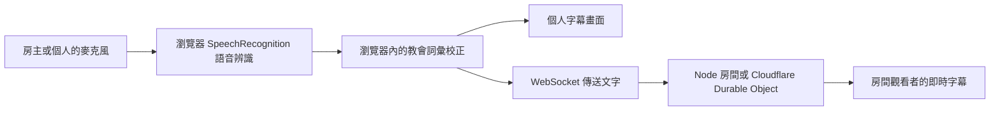

# 語音、字幕與教會詞彙

## 目前實作

網頁呼叫 `SpeechRecognition` / `webkitSpeechRecognition`，語言 `zh-TW`，開啟 continuous 和 interimResults。暫定字幕可以先顯示，之後由確定結果取代；瀏覽器結束一段辨識時，收音狀態允許自動重啟。

實際語音模型由瀏覽器／供應商決定，專案不知道其版本，也沒有自行執行 Whisper。音訊可能送至瀏覽器供應商服務；本專案的 Node／Cloudflare 後端只收到文字，不接收或訓練音訊。

個人模式在自己的頁面處理字幕；廣播模式由房主校正後傳送文字，觀看者只接收字幕，因此觀眾不需要各自執行辨識模型。房主憑證允許廣播及關閉房間，房間密碼或邀請憑證允許觀看。QR Code 帶有觀看憑證。

詞彙校正表目前執行字串替換，最長匹配優先、避免替換結果再次被校正。例如 `耶蘇=耶穌`。這可以修復固定誤識，但不會改變辨識引擎，無法可靠解決同音、上下文與複雜經文引用，替換也可能誤改一般文字。

## 建議的下一階段：先改善辨識，再決定訓練

| 方式 | 用途 | 成本與限制 |
| --- | --- | --- |
| 現有詞彙替換 | 快速修正常見教會誤識 | 輕量，可能誤改；不會提高聲音辨識能力 |
| 支援詞彙提示的語音 API | 使用講道主題、書卷及姓名作提示 | 提示效果因服務而異，通常有用量費用 |
| 本機 Whisper + 詞彙提示 | 自行控制辨識、音訊留在教會電腦 | 不須每位觀眾跑模型，但需要測試主機效能 |
| 微調開源模型 | 改善特定講員、教會詞彙或收音環境 | 需要授權音檔、人工逐字稿、GPU 與獨立評估 |

我建議先以 **多語版 Whisper small + faster-whisper 的 int8 推論** 做原型。不要選 `.en`（英文限定）。`small` 約 244M 參數；`base` 約 74M、`tiny` 約 39M 可以作速度比較，但中文及專有名詞品質必須實測，較小不保證適合聚會。這些模型不是現在程式的依賴。

Whisper small 在教會一台主電腦執行即可，Cloudflare 繼續只分發文字。一般 Workers／Durable Objects 不適合訓練或長時間跑這類語音模型。Workers AI 是另外的服務，有不同模型、能力、額度與價格；不能把免費網站部署等同於免費且無限制的語音辨識。

### 如何開發自有語音辨識

1. 建立 Python 語音服務，採 `faster-whisper`，先使用取得授權的錄音測試 `small` 與 `base`。在 CPU 測試 int8，若有 GPU 再測試合適精度。
2. 將教會專用詞、講員姓名與當日書卷整理成簡短的 `initial_prompt`。這是上下文提示，不是模型訓練，也不保證輸出正確。
3. 用 VAD 偵測說話；若做 Whisper 即時化，可分段加重疊窗口、保留上下文並去重。它是分段近即時辨識，需要另行實作暫定／確定字幕邏輯，不是原生串流辨識。
4. 把這個辨識來源接到網頁既有的字幕事件，再套用可編輯詞彙表及房間廣播。模型只在房主端／單一語音服務跑。
5. 測量中文字符錯誤率 CER、教會專有名詞正確率、字幕延遲，以及處理音訊速度。若辨識速度慢於錄音速度，會持續累積延遲，必須調整模型、硬體或改用串流引擎。

Whisper 可以有較好的開源工具支持，但如果分段延遲不符合現場需求，也應評估專門做串流辨識的中文模型，例如 sherpa-onnx 支援的中文串流模型。需確認模型授權、詞彙提示能力及繁體輸出，不應僅憑模型名稱選用。

### 什麼時候才微調模型

在基礎模型＋詞彙提示仍有固定、可量測的錯誤時再開始：

1. 收集經授權、能代表真實聚會的錄音；包括不同講員、麥克風、距離與背景噪音，並人工核對逐字稿。不能只提供聖經文字，因為聲學模型需要音訊與對應文字。
2. 依講員／聚會場次切分訓練、驗證及測試集，避免同一段錄音或同一場的相近片段洩漏到不同集合。另保留一般中文測試資料。
3. 用 Hugging Face Transformers 的 Whisper 訓練流程做全參數微調，或評估 PEFT／LoRA。LoRA 可減少可訓練參數與訓練記憶體，仍要載入基礎模型，不保證大幅降低推論成本。
4. 在 GPU 上訓練，依 CER 與專有名詞結果選 checkpoint；同時檢查是否損害一般中文辨識、增加靜音幻覺。不要只看訓練 loss。
5. 如採 LoRA，先合併／匯出與部署引擎相容的權重，再轉成 CTranslate2 格式供 faster-whisper 使用，重新測試 int8 精度與字幕延遲。
6. 保存模型版本、詞彙表版本及評估結果，可以回退至基礎模型。先小規模試用，再替換現有瀏覽器辨識來源。

目前沒有使用者錄音、訓練資料或 GPU 訓練工作，所以專案不宣稱已訓練或達到教會用語的特定準確率。
